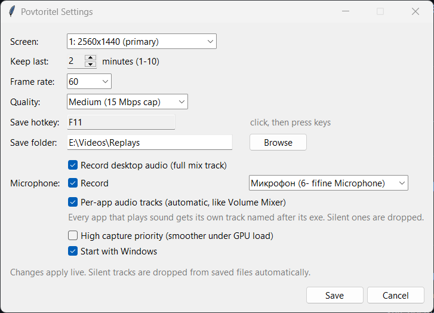

# Povtoritel

Povtoritel is a Windows application for instant replay and continuous screen
recording. It keeps the selected time window in RAM and saves it to MP4 on
request. The application operates from the system tray and can start with
Windows.



## Requirements

- Windows 10 or Windows 11
- Python 3.12 or later
- NVIDIA or AMD GPU with a supported hardware encoder

## Installation

```powershell
git clone https://github.com/razreshitel/povtoritel.git
cd povtoritel
powershell -ExecutionPolicy Bypass -File setup.ps1
.\Povtoritel.exe
```

The setup script downloads FFmpeg 8.1.2 (checksum verified) and, when Visual Studio C++ Build Tools are
installed, builds `Povtoritel.exe`: a small launcher that runs the application
in-process with its own name and icon, so Task Manager shows "Povtoritel"
instead of Python. Rebuild it with `launcher\build.ps1` after changing the
Python version. Without the launcher, `pythonw povtoritel.pyw` still works; when
the launcher exists, it is used automatically. On first launch, the application
creates its configuration, tray icons, and autostart entry.

## Usage

- The replay hotkey saves the configured number of recent minutes.
- The recording hotkey starts or stops continuous recording.
- Continuous recording can instead use a two-second hold of the replay hotkey.
- During continuous recording, a small red corner mark (4x4 px L shape,
  2 px thick) stays in the top-right corner of the captured screen. It is
  excluded from the recording and from screen sharing.
- While continuous recording is active, the tray menu offers "Delete
  recording without saving": after confirmation it stops the recording and
  deletes its temporary file.
- Stopping a recording or saving a replay shows a notification at once; a
  second notification with the file size follows when the file is written.
  A new recording can be started while the previous file is still being
  written.
- A recording survives capture restarts: it continues in a new segment and
  the segments are joined into one MP4 when it stops.
- If Windows shuts down or the application is killed during a recording, the
  recorded part is saved as `recording_..._recovered.mp4` on the next start.
- Quitting during a recording finishes the file before the application exits.
- Tray icon: click or right-click opens the menu, double-click opens Settings.
- Additional held Shift, Ctrl, or Alt keys do not prevent a configured hotkey
  from working. If replay and recording combinations overlap, recording takes
  priority and only one action is performed.
- Settings can be changed from the tray menu and are applied without restarting
  the application.

The tray icon indicates the current state:

- Green: buffering is active.
- Gray: buffering is paused.
- Red: continuous recording is active.

Recordings are saved to the folder selected in Settings. Notifications are
displayed on the captured screen and are excluded from the recording; a
standard tray balloon is used only if the notification window fails.

## Commands

```powershell
.\Povtoritel.exe
py povtoritel.pyw --settings
py povtoritel.pyw --save
py povtoritel.pyw --reload
py povtoritel.pyw --quit
py povtoritel.pyw --check
```

Launching the application while it is already running opens Settings.

## Notes

- One screen is recorded at a time.
- Desktop audio is saved as a Full track (desktop + microphone). Microphone
  and automatic per-application tracks remain separate and configurable.
- Per-application tracks use 6 slots (`app_slots`). When all slots are taken
  and another application plays sound, the slot that has been silent longer
  than the buffer is reassigned (never during a long recording). Sound that
  gets no slot stays in the Full/Desktop track.
- "Ignore apps" in Settings (`app_exclude`) lists executables that never get
  their own track; `picomicdrainer.exe` is ignored by default.
- The RAM buffer is cleared when capture restarts.
- `povtoritel.log` rotates at 1 MB and `ffmpeg.log` at 2 MB (one `.old` copy
  each).
- Screen lock and display sleep temporarily suspend capture. Recovery is
  automatic when the desktop becomes available.
- `mpo_disable.reg` can improve capture stability under high GPU load. A sign
  out or restart is required after applying it. `mpo_enable.reg` restores the
  default Windows setting.
